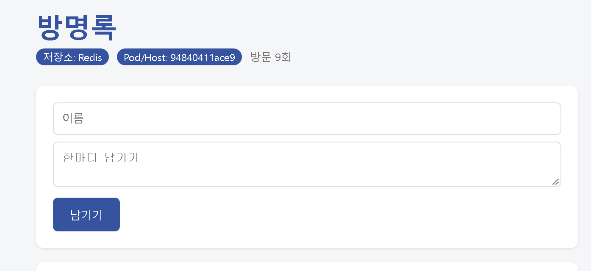
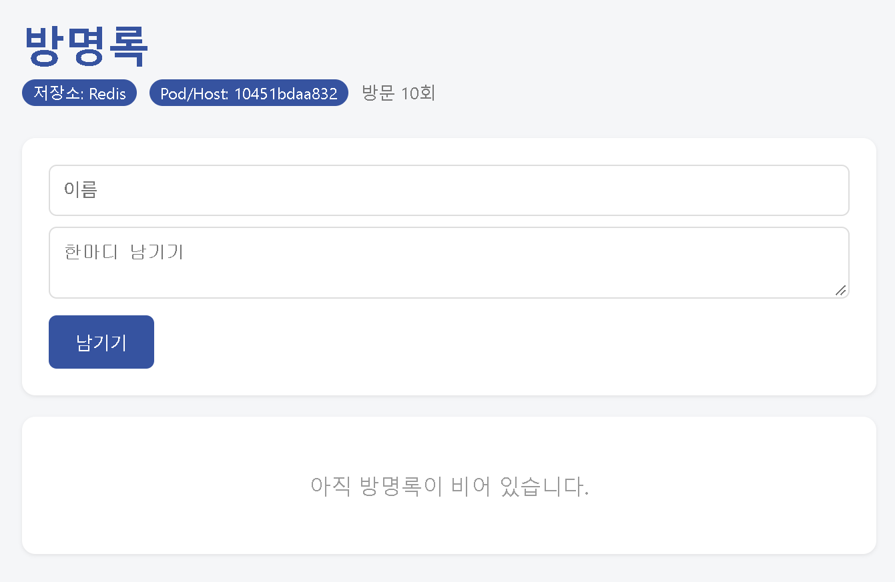

# 7주차
## 과제
- docker compose ps 결과 (healthy 포함)

- scale 후 각 웹 컨테이너 호스트명(컨테이너 ID)바뀐 결과

- down 후 up과 down -v후 up 차이 비교 
| 구분 | `docker compose down` 후 `up` | `docker compose down -v` 후 `up` |
| :--- | :--- | :--- |
| **Volume(볼륨) 삭제 여부** | 데이터 볼륨 유지 | 데이터 볼륨까지 **완전 삭제** |
| **방명록 데이터 보존** | 기존 작성된 데이터가 **그대로 남아있음** | 기존 작성된 데이터가 **초기화되어 삭제됨** |
| **주요 용도** | 컨테이너 재시작 및 단순히 앱을 다시 배포할 때 | DB 및 영구 데이터를 완전히 초기화하고 싶을 때 |

- .env를 Git에 올리지 않는 이유 
	- 보안성 
		- '.env' 파일은 DB 비밀번호, AAPI 키, 인증토큰등 주요 민감정보를 담고있기 때문이다
		

### 도커 컴포즈 
- Compose 
	- 여러 요소를 조합하여 하나를 완성하는것 
	- cpmpose.yaml = 여러 컨테이너를 파일 (코드)로 
- 도커 
	- 각각의 기능들을 탑재한것 
- 도커 컴포즈 
	- 독립된 컨테이너들이 함께 동작하도록 구성 및 관리하는 도구
- 컨테이너 
	- 역할 하나만 부여함 
	- 볼륨 
		- 컨테이너는 일회용 데이터는 영구 
		  < down -v 는 데이터까지 삭제 >
	- 네트워크 
		- REDIS_HOST : "redis"
			- IP 가 아닌 '이름' 작성 
		- 컴포즈가 네트워크 만들고 서비스 이름 DNS에 등록 
#### 간단하게 정리
- docker run : 
	- 개별 컨테이너를 직접 실행하고 관리
- docker compose : 
	- 여러 컨테이너의 구성을 정의하고 단일 도커 엔진 환경에서 관리
- Kubernetes : 
	- 여러 컴퓨터에 걸쳐 컨테이너 기반 서비스를 실행하고 원하는 상태가 유지되도록 자동 관리
