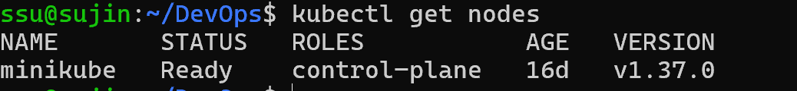
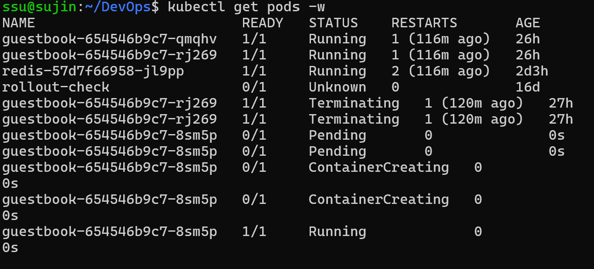
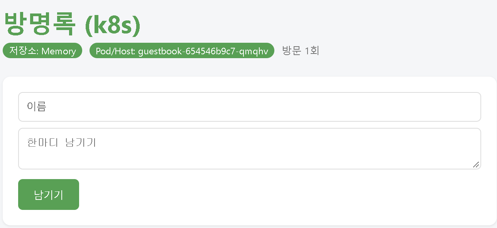

# 9주차
## 혼자 해보기



- <선언형> (Declarative)
    - *원하는 상태 선언후 지속적 유지* 하는 것이 특징 
    - Pod 개수를 계속 측정
        - 예시
            ```
            명령형 
                - A는 주방 B는 홀을 맡아
                - 만약 A가 안나올시 다시 사장이 명령
            선언형 
                - 주방에 항상 2명 홀에는 항상 3명을 선언
                - 매니저가 알아서 관리
            ```


## 용어 정리 
- 쿠버네티스 
    - 컨테이너화된 애플리케이션 배포, 확장, 관리를 자동으로 처리해주는 오픈 소스 시스템
- 클라스터
    - 1개 이상의 노드로 구성된 쿠버네티스 관리 환경 
    - *여러개의 서버(컴퓨터)를 한개로 묶어 관리*
        - Control Plane
            - 클러스터를 관리하는 두뇌 
        - 네임 스페이스 
            - 클러스터 안의 칸막이 
        - Kubectl
            - 클러스터에 명령을 보내는 도구 
- 노드 
    - 컨테이너가 실제로 도는 서버 
- Pod 
    - 컨터이너를 감싼 최소 단위 
- YAML 
    - compose.yaml과 같은 결이지만 더 큰 규모이다

## 쿠버네티스 관리 체계 
```
쿠버네티스(관리 체계)
└─ 클러스터(관리 대상 전체)
   ├─ 노드 1
   │  └─ Pod
   │
   └─ 노드 2
      ├─ Pod
      └─ Pod

```

### 쿠버네티스 
#### <오케스트레이션>
- Orchestration
    - 여러서버의 컨테이너들을 자동으로 배치하고 관리
    - 자동으로 관리해주는 시스템 
    |  | 도커컴포즈 | 쿠버네티스 |
    |---|---|---|
    | 무대 | 한무대  | 여러 공연장 |
    | 악보 | compose.yaml | 매니 페스트 YAML 여러개  |
    | 연주자가 쓰러지면  | 다시 일으킴 (restart) | 대채자 투입 |
    | 지휘자 | docker compose up 한번 | 계속 지켜보며 맞춤 |
#### <선언형> (Declarative)
- *원하는 상태 선언후 지속적 유지* 하는 것이 특징 
- Pod 개수를 계속 측정
    - 예시
        ```
        명령형 
            - A는 주방 B는 홀을 맡아
            - 만약 A가 안나올시 다시 사장이 명령
        선언형 
            - 주방에 항상 2명 홀에는 항상 3명을 선언
            - 매니저가 알아서 관리
        ```
#### <조정 루프> (reconciliation loop)
- 관찰 -> 비교 -> 조치 -> 관찰 로 계속 선언명령이랑 맞추어 보는것
```
1. 관찰
    - 지금 Pod가 몇개? => 2개 
2. 비교 
    - 원하는건 3개야 => 1개 부족
3. 조치 
    - 1개 더 추가 생성 => 다시 관찰
```

