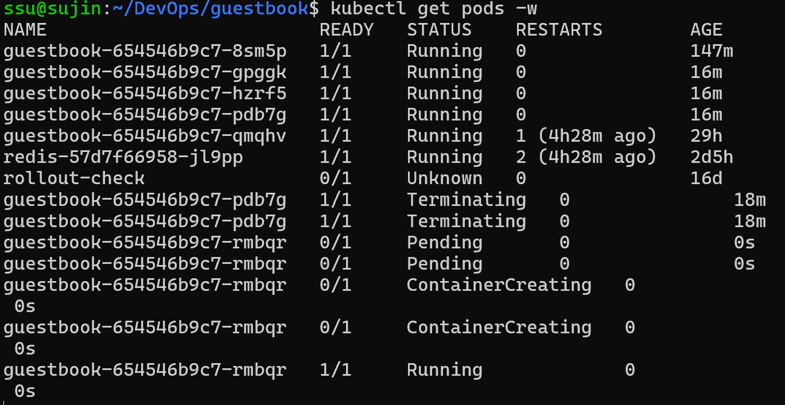
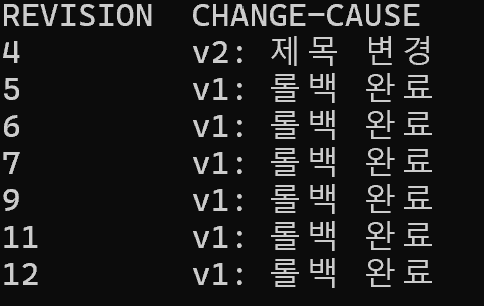

# 10 주차 
## 혼자 해보기
- replicas 5개로 늘리기

- 서비스 통과한 요청에서 서로다른 POD hostname  


- 강제 삭제후 살아나는 Pod 

- kubectl rollout history 결과


## 단어 정의 
- Deployment
    - 앱을 어떤 모습으로 배치할지 선언 (버전, 갯수, 교체 방법 )
- ReplicaSet
    - 똑같은 Pod 복제본 묶음의 개수를 유지 하는 담당자 
- replicas :2
    - 복제본 2개 원함

### YAML에서 기억해야 할 4가지
- YAML 읽는 방법
| 필드 | 의미 |
| --- | --- |
| apiVersion | 이 종류를 다루는 API 버전 |
| kind | 무엇을 만들까? |
| metadata | 이름표(이름, 레이블) |
| spec | 원하는 상태 |

- 가장 실수가 잦은 곳 
    - selector.matchLabels = template.metadata.labels
- 규칙
    - Compose.yaml과 동일 규칙
### template 
- template =  Pod 설계도
```
- 예시 
    - Pod = 틀에서 찍어낸 붕어빵 
        - 틀이 바뀌면 이미지(V1 -> V2)
            - 새틀로 다시 구워서 교체 (롤링 업데이트)
        - 붕어빵을 하나 먹으면 (Pod 삭제)
            - 같은 틀로 다시 굽기 (자가 치유) 
```
### 레이블과 셀렉터
- 레이블 (label)
    - IP, 이름을 몰라도 레이블만드로도 찾을 수 있음
    - 역할
    ```
        이어주는 역할 (세곳 모두 app: guestbook 사용)
        deployment.yaml                      service.yaml
    ┌──────────────────────────┐          ┌───────────────────┐
    │ selector:                │          │ selector:         │
    │   matchLabels:           │          │ app: guestbook    │
    │       app: guestbook ──┐ │          └─────────┬─────────┘
    │ template:              │ │                   │
    │   metadata:            │ 다르면 안됨!         │  Pod 요청
    │       labels:          ▼ │                   ▼
    │           app: guestbook─┼──▶ [Pod] app=guestbook 
    └──────────────────────────┘
    ```
- 셀렉터 (selector)
    - 레이블로 골라내는 조건
### 서비스(Service)
- 필요 이유
    - Pod가 죽었다 살아나면 IP주소가 바뀜
    - 사용자는 어느 IP로 접속? 
        - 대표 번호가 필요한 이유
    ```
    [Service: guestbook]    # 고정된 이름, 고정된 IP
            │  selector: app=guestbook
   ┌────────┼────────┐
   ▼        ▼        ▼
  [Pod]   [Pod]    [Pod]   # 트래픽 자동 분배 (로드밸런싱)
    ```

### git revert 
- 과거 커밋 기록을 삭제 하지 않고 변경사항을 취소 
```
    A -> B -> C (HEAD)
```
-  B의 변경사항을 취소하고 싶을떄 
```
    git revert B 
```
- 결과 
```
    A -> B -> C -> D (HEAD)
                   ^
                   |
        " B의 변경을 취소한 커밋 "
```
    - B 와 C는 남아있고 B의 변경사항을 되돌리는 D가 추가

### git reset 
- 커밋 기록의 기준점을 과거로 되돌리는것 
```
git reset --soft
    - HEAD로 이동하되, 변경사항은 스테이지 영역에 유지

git reset --hard
    - HEAD로 이동하되, 작업 파일까지 대상 커밋 상태로 변경 
```
*git revert- 잘못 작성한 내용을 취소한 기록을 새로 남기는 것*
